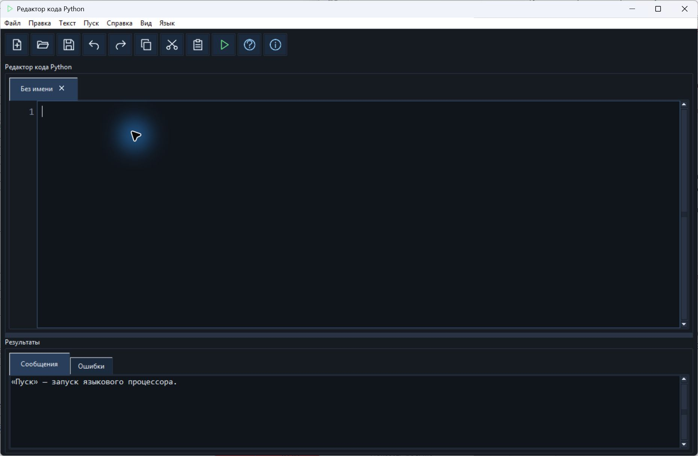
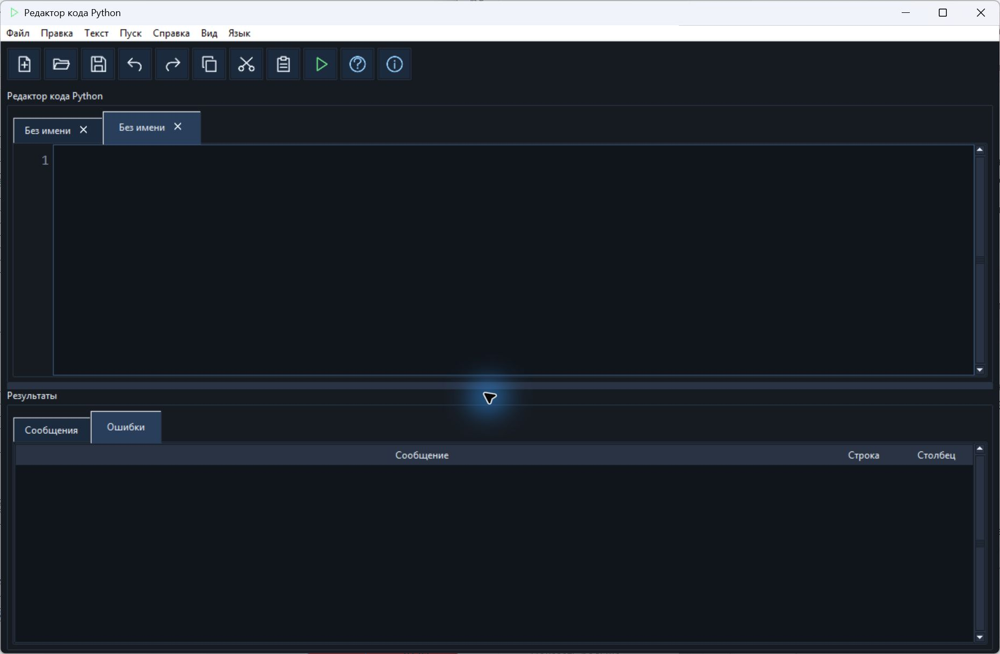
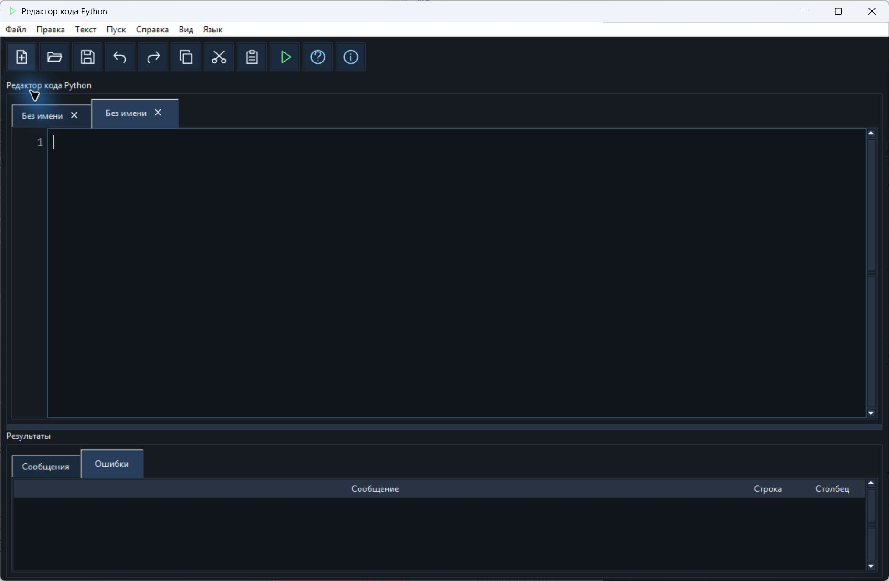
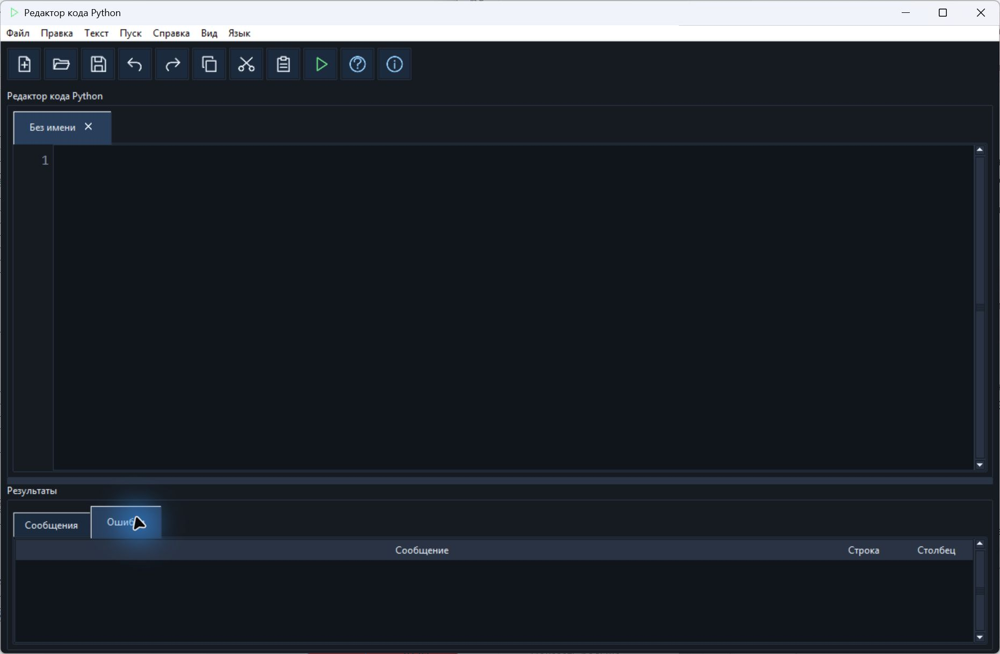
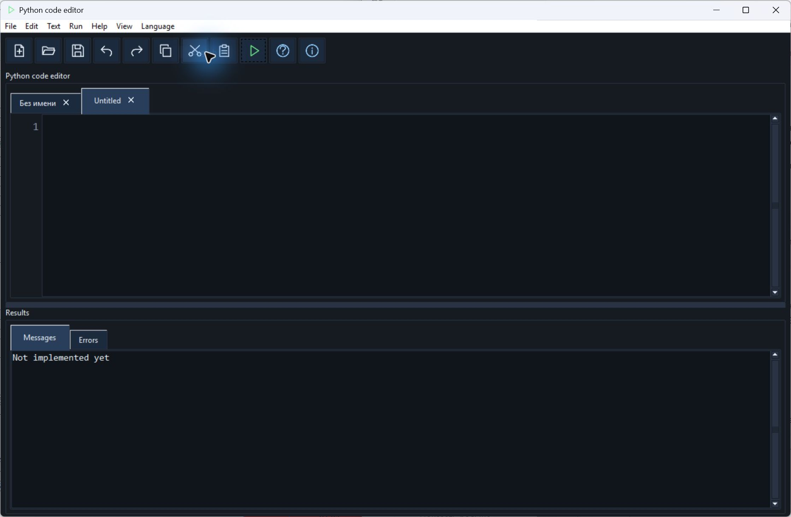

# Редактор кода Python

Задание 2 «Программная реализация GUI». Автор — Рудик Дана.

## 1. Возможности редактора

Редактор кода Python — приложение на Python и Tkinter для подготовки исходных текстов. В нём можно создавать, открывать, редактировать и сохранять документы. Нижняя область показывает сообщения приложения.

Используйте редактор, чтобы набрать учебный пример, изменить его и сохранить на диске. Для нескольких документов используются отдельные вкладки. В нижнем поле можно увидеть, например, сообщение о том, какой файл был открыт.

## 2. От открытия приложения до выхода

Начните с проверки Python и откройте папку с файлами проекта. Когда закончите работу, сохраните документ перед закрытием окна.

### 2.1. Как открыть редактор в Windows

Установите Python 3 с Tkinter. Откройте терминал в папке GUI, выполните py editor.py и дождитесь появления окна. IDE и пакеты из pip не требуются.

В Проводнике откройте папку, где лежит editor.py. Откройте в ней терминал и выполните py -3 editor.py. Храните рядом папку icons и файл README.md. Из этой папки редактор загружает значки кнопок, а из README.md берёт текст справки.

### 2.2. Как закрыть окно

Выберите «Файл → Выход» или нажмите крестик. При наличии правок ответьте на запрос о сохранении. При выходе программа последовательно проверяет все открытые документы.

Перед закрытием посмотрите на заголовок окна. Если есть звёздочка, выберите «Да» в запросе, чтобы записать правки. Если нужно продолжить редактирование, нажмите «Отмена».

## 3. Что находится на экране

В заголовке указано название приложения, а после открытия или сохранения — также имя файла. Меню и кнопки находятся сверху. Текст вводится в верхнем поле, сообщения появляются в нижнем. Строка состояния сообщает, есть ли несохранённые изменения.

Меню находится над панелью инструментов. Кнопки с иконками выполняют команды меню. При наведении появляется название команды. Зелёный треугольник в общем ряду кнопок обозначает «Пуск». Щёлкните по верхнему полю, чтобы поставить курсор и начать ввод. Нижнее поле защищено от редактирования.

На панели слева направо расположены создание, открытие, сохранение, отмена, повтор, копирование, вырезание, вставка, пуск, справка и сведения о программе. Иконки имеют размер 24 × 24 пикселя.

Рисунок 1 — Главное окно с обновлённой панелью действий

### 3.1. Как увеличить рабочее поле

Измените размер окна за его край. Потяните горизонтальную полосу между редактором и результатами вверх или вниз. Высоту области результатов можно менять, перетаскивая разделитель.

Потяните правый нижний угол окна или разверните его системной кнопкой в заголовке. Можно увеличить редактор для работы с длинным документом или нижнюю панель для просмотра сообщений. Если строка не помещается по ширине, переместите горизонтальный бегунок в редакторе.

Наведите указатель на полосу между областями. Когда курсор сменится на вертикальную двунаправленную стрелку, удерживайте левую кнопку мыши и перемещайте полосу. Отпустите кнопку на удобной высоте.

Рисунок 2 — Изменение соотношения высоты редактора и результатов

## 4. Документы от создания до сохранения

Новый документ получает имя после первого сохранения. При работе с существующим файлом его имя видно в заголовке, поэтому перед сохранением можно проверить, какой документ открыт.

### 4.1. Начало работы с чистого листа

Выберите «Файл → Создать» или нажмите Ctrl+N. Введите текст в верхнем поле.

Нажмите «Создать» и дождитесь новой вкладки с пустым полем. Введите items = [1, value, -2,]. Перед переходом к другому файлу сохраните пример под отдельным именем, например example.py.

Каждый новый документ появляется в своей вкладке. Щёлкните название вкладки для переключения. У каждой вкладки своя история правок. Чтобы закрыть документ, нажмите крестик справа от имени или Ctrl+W. При несохранённых правках появится запрос. После закрытия последней вкладки создаётся пустая.

Рисунок 3 — Документы с отдельными кнопками закрытия

### 4.2. Загрузка текста с диска

Нажмите Ctrl+O или выберите «Файл → Открыть». Укажите файл в кодировке UTF-8.

В диалоге перейдите в нужную папку. Выберите файл и нажмите «Открыть». Для других расширений переключите тип на «Все файлы». Кнопка «Отмена» закрывает диалог выбора.

В поле «Имя файла» можно ввести имя вручную или щёлкнуть по файлу в списке. Если нужный документ не виден, проверьте выбранную папку и фильтр справа от поля. После открытия имя документа появится в заголовке. Если чтение завершится ошибкой, прежний текст останется в редакторе.

В Windows можно перетащить один или несколько файлов из Проводника на окно редактора. Файлы открываются в отдельных вкладках. Повторное открытие того же пути переключает на существующую вкладку. Для файлов другого расширения выберите в диалоге «Все файлы». Содержимое должно быть текстом в UTF-8.

### 4.3. Запись текста в файл

Ctrl+S записывает текст в текущий файл и предлагает выбрать путь при первом сохранении. Ctrl+Shift+S открывает выбор нового пути. Звёздочка в заголовке показывает наличие правок.

В диалоге первого сохранения выберите папку и введите имя, например example.py. Чтобы создать копию, воспользуйтесь «Сохранить как» и задайте другое имя. Следующий Ctrl+S запишет текст по новому пути. После успешной записи звёздочка исчезнет.

Проверьте папку и имя перед нажатием «Сохранить». Для кода оставьте тип Python (*.py). Чтобы сохранить обычный текст, выберите тип «Текст». Если создаёте копию через «Сохранить как», дайте ей отдельное имя. В заголовке появится имя копии, и последующие нажатия Ctrl+S будут записывать правки в неё.

### 4.4. Выбор при наличии несохранённых правок

При закрытии изменённой вкладки или выходе «Да» сохраняет правки, «Нет» продолжает закрытие, а «Отмена» оставляет документ открытым. Создание и открытие файла добавляет отдельную вкладку.

Если выбрать «Да» для нового документа, сначала откроется окно выбора имени файла. Если отменить сохранение в этом окне, исходное действие тоже прервётся. После ошибки записи можно выбрать другую папку и повторить сохранение.

## 5. Как менять текст

Перед редактированием поставьте курсор в нужное место или выделите фрагмент мышью. Команды доступны через меню «Правка», а часто используемые действия вынесены на панель.

### 5.1. Выделение текста и буфер обмена

| Команда | Действие |
| --- | --- |
| Вырезать · Ctrl+X | Переносит выделение в буфер |
| Копировать · Ctrl+C | Копирует выделенный текст |
| Вставить · Ctrl+V | Вставляет текст из буфера |
| Удалить | Удаляет выделение или символ справа от курсора |
| Выделить все · Ctrl+A | Выделяет содержимое документа |

Чтобы переместить фрагмент, выделите его, нажмите Ctrl+X, поставьте курсор в другое место и нажмите Ctrl+V. Для создания копии используйте Ctrl+C. Команда «Удалить» убирает выделение, а без выделения удаляет символ справа от курсора.

### 5.2. Возврат к предыдущей правке

Ctrl+Z отменяет последнюю правку. Ctrl+Y повторяет отменённую правку. Эти команды также доступны на панели.

Если вставка оказалась лишней, нажмите Ctrl+Z и проверьте текст. Ctrl+Y вернёт отменённое изменение. После открытия другого документа история правок начинается заново.

Как проверить отмену и повтор на двух строках

1. Впишите под первой строкой empty = [].

2. Выделите вторую строку и нажмите Ctrl+X. Она исчезнет из поля и попадёт в буфер обмена.

3. Нажмите Ctrl+Z, чтобы вернуть строку, и Ctrl+Y, чтобы снова её убрать.

4. Поставьте курсор в конец документа и нажмите Ctrl+V. Текст из буфера появится в выбранной позиции.

### 5.3. Навигация по длинному документу

Используйте вертикальную прокрутку для длинных документов и горизонтальную для строк, выходящих за ширину редактора.

Перетащите вертикальный бегунок, чтобы перейти к другой части документа. В редакторе длинные строки можно просматривать горизонтальной полосой. Нижнее поле можно прокручивать вертикально.

Чтобы свериться с заданием, откройте «Текст → Постановка задачи». В этом окне описаны допустимые элементы списка и правила записи. Например, в items = [1, value, -2,] есть число, имя переменной, отрицательное число и завершающая запятая. Закройте окно и продолжите работу с примером в редакторе.

В меню «Вид» выберите увеличение или уменьшение текста редактора либо результатов. Ctrl++ и Ctrl+- изменяют текст во всех вкладках документов. Диапазон размера шрифта составляет 8–32 пункта. Номера строк подстраиваются под размер текста. Строка состояния показывает текущую строку и столбец курсора.

## 6. Команда запуска и сообщения редактора

Введите учебный пример в верхнее поле. После нажатия «Пуск» посмотрите на нижнюю область, где программа показывает состояние операции.

### 6.1. Что происходит при нажатии кнопки Пуск

Нажмите «Пуск» в меню или кнопку с зелёной иконкой. Текущая версия выводит сообщение «Пока не реализовано».

Откройте «Текст → Постановка задачи», чтобы посмотреть, какие записи предусмотрены заданием. Например, items = [1, value, -2,] содержит числа и имя переменной. При запуске текущая версия показывает сообщение «Пока не реализовано».

После нажатия зелёной кнопки приложение переключает нижнюю область на «Сообщения». В текущей версии отображается «Пока не реализовано».

Рисунок 4 — Сообщение после нажатия кнопки Пуск

### 6.2. Что показывает нижнее поле

Вкладка «Сообщения» показывает сообщения о действиях. Вкладка «Ошибки» содержит таблицу с описанием, строкой и столбцом. После подключения парсера выбор записи ошибки будет переводить курсор в соответствующий документ.

Нижнее поле также показывает сообщения о создании документа или открытии файла. Чтобы изменить исходный текст после чтения сообщения, щёлкните по верхнему полю.

Для просмотра таблицы щёлкните вкладку «Ошибки». Пока парсер ещё разрабатывается, таблица пуста. Увеличить её высоту можно разделителем.

Рисунок 5 — Тёмная таблица ошибок

## 7. Где найти помощь

Справка пригодится, если нужно вспомнить сочетание клавиш или порядок сохранения. Информацию об авторе можно открыть отдельно.

### 7.1. Открытие руководства из редактора

Нажмите кнопку «Справка» или выберите «Справка → Вызов справки». Руководство откроется в отдельном окне.

Прокрутите текст справки, чтобы найти нужный раздел. Для возврата к документу нажмите «Закрыть» внизу окна справки или Escape.

Рисунок 6 — Обновлённая встроенная справка

### 7.2. Название приложения и сведения об авторе

В меню «Справка» выберите «О программе», чтобы посмотреть название приложения, номер задания и имя автора.

Окно «О программе» можно вызвать и одноимённой кнопкой на панели. Для закрытия сообщения нажмите OK.

В меню «Язык» выберите English или «Русский». Меняются основные команды, кнопки и подписи областей. Учебные материалы и текст руководства приведены на русском.

Рисунок 7 — Основные команды на английском языке

## 8. Примеры действий в редакторе

По этим сценариям можно пройти весь путь от первого запуска до записи правок и закрытия программы.

### 8.1. От пустого окна до первого файла

Нажмите Ctrl+N, введите items = [1, value, -2,] и нажмите Ctrl+S. В диалоге укажите имя файла.

Введите пример, выберите папку в диалоге и сохраните его как example.py. Проверьте, что имя появилось в заголовке окна.

### 8.2. Как обновить текст на диске

Откройте файл через Ctrl+O, измените текст и сохраните его через Ctrl+S.

Добавьте число в список и сохраните файл. Откройте его снова и проверьте, что изменение осталось в тексте.

### 8.3. Как сохранить правки перед выходом

Если в заголовке есть звёздочка, сохраните текст перед выходом или выберите «Да» в запросе при закрытии.

Чтобы проверить запрос, внесите правку и выберите «Файл → Выход». Нажмите «Отмена» и убедитесь, что документ остался открытым. Затем сохраните изменения и закройте окно.

Как проверить сохранение копии

1. Откройте example.py и выберите «Файл → Сохранить как».

2. Введите имя example-copy.py и нажмите «Сохранить». Проверьте новое имя в заголовке.

3. Внесите правку и нажмите Ctrl+S. Затем по очереди откройте оба файла. Правка должна быть видна в копии, а исходный файл будет содержать прежний текст.

## 9. Что доступно на этом этапе

Синтаксический анализатор подключается на следующем этапе. Одновременно можно работать с несколькими документами. Во вкладках доступны номера строк и подсветка ключевых слов Python, строк, чисел и комментариев.

Редактор можно использовать для подготовки текста учебного примера. Проверка его синтаксиса запланирована на этапе подключения анализатора.

## 10. Что проверить при сбое

| Проблема | Что сделать |
| --- | --- |
| Окно не открывается | Проверьте наличие Python с Tkinter и папки icons. |
| Справка не открывается | Проверьте, что README.md лежит рядом с editor.py. |
| Файл не читается | Проверьте, что файл сохранён в UTF-8. |
| Файл не сохраняется | Выберите папку с разрешением на запись через «Сохранить как». |

Начните с сообщения программы. При ошибке открытия проверьте путь к файлу и кодировку UTF-8. При ошибке записи попробуйте сохранить файл под другим именем в папку, где у вас есть право записи.
