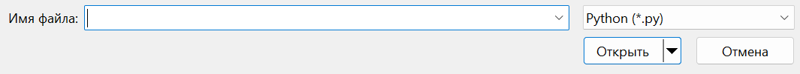
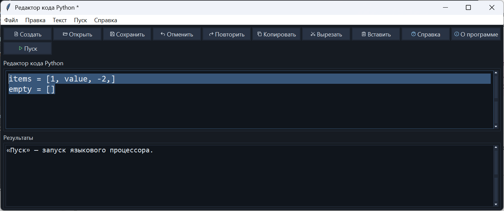
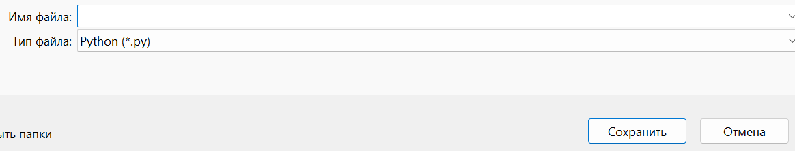
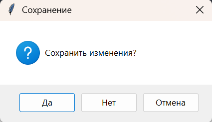
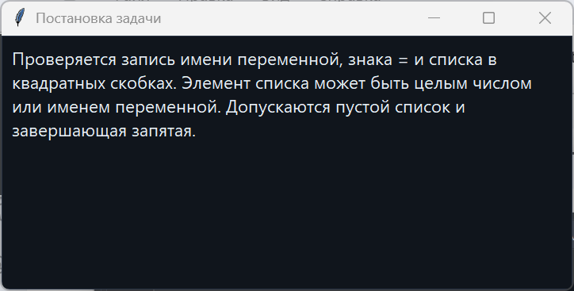
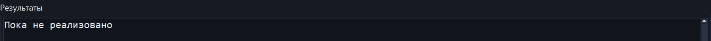
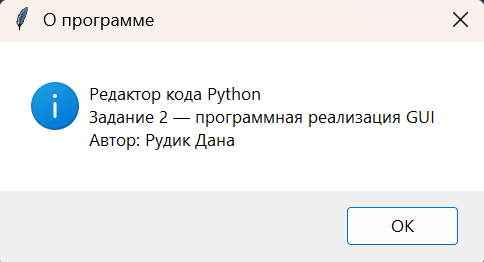

# Редактор кода Python

Задание 2 «Программная реализация GUI». Автор — Рудик Дана.

## 1. Возможности редактора

Редактор кода Python — приложение на Python и Tkinter для подготовки исходных текстов. В нём можно создавать, открывать, редактировать и сохранять документы. Нижняя область показывает сообщения приложения.

## 2. От открытия приложения до выхода

### 2.1. Как открыть редактор в Windows

Установите Python 3 с Tkinter. Откройте терминал в папке GUI, выполните py editor.py и дождитесь появления окна. IDE и пакеты из pip не требуются.

Если установлено несколько версий Python, команда `py -3 editor.py` запустит редактор через Python 3. Откройте терминал в папке, где лежит `editor.py`. Рядом должны находиться `README.md` и папка `icons`, чтобы работали справка и кнопки.

### 2.2. Как закрыть окно

Выберите «Файл → Выход» или нажмите крестик. При наличии правок ответьте на запрос о сохранении.

## 3. Что находится на экране

В заголовке указано название приложения, а после открытия или сохранения — также имя файла. Меню и кнопки находятся сверху. Текст вводится в верхнем поле, сообщения появляются в нижнем. Строка состояния сообщает, есть ли несохранённые изменения.

Рисунок 1 — Главное окно программы

### 3.1. Как увеличить рабочее поле

Измените размер окна за его край. Дополнительную высоту получает редактор. Высота области результатов фиксирована.

## 4. Документы от создания до сохранения

### 4.1. Начало работы с чистого листа

Выберите «Файл → Создать» или нажмите Ctrl+N. Введите текст в верхнем поле.

Если нужен отдельный файл для экспериментов, создайте пустой документ, введите `items = [1, value, -2,]` и сохраните его как `example.py`. После этого можно открыть файл повторно и проверить, что текст записался.

### 4.2. Загрузка текста с диска

Нажмите Ctrl+O или выберите «Файл → Открыть». Укажите файл в кодировке UTF-8.

1. В диалоге открытия перейдите в папку с нужным файлом.
2. Выберите файл или введите его имя. Для поиска файла с другим расширением переключите список типов на «Все файлы».
3. Нажмите «Открыть». Редактор загрузит содержимое и покажет имя файла в заголовке. Чтобы вернуться к текущему документу, нажмите «Отмена».

Рисунок 2 — Нижняя часть диалога открытия

### 4.3. Запись текста в файл

Ctrl+S записывает текст в текущий файл и предлагает выбрать путь при первом сохранении. Ctrl+Shift+S открывает выбор нового пути. Звёздочка в заголовке показывает наличие правок.

Рисунок 3 — Изменённый документ и выделенный текст

При первом сохранении выберите папку, введите имя файла и нажмите «Сохранить». Для копии под другим именем выберите «Сохранить как» и укажите новый путь. Последующие нажатия Ctrl+S будут сохранять изменения по этому пути. После успешной записи звёздочка исчезнет.

Рисунок 4 — Нижняя часть диалога сохранения

### 4.4. Выбор при наличии несохранённых правок

При создании, открытии или закрытии изменённого документа «Да» сохраняет правки, «Нет» продолжает действие без сохранения, а «Отмена» оставляет документ открытым.

Рисунок 5 — Запрос о сохранении изменений

## 5. Как менять текст

### 5.1. Выделение текста и буфер обмена

| Команда | Действие |
| --- | --- |
| Вырезать · Ctrl+X | Переносит выделение в буфер |
| Копировать · Ctrl+C | Копирует выделенный текст |
| Вставить · Ctrl+V | Вставляет текст из буфера |
| Удалить | Удаляет выделение или символ справа от курсора |
| Выделить все · Ctrl+A | Выделяет содержимое документа |

### 5.2. Возврат к предыдущей правке

Ctrl+Z отменяет последнюю правку. Ctrl+Y повторяет отменённую правку. Эти команды также доступны на панели.

Чтобы перенести фрагмент, выделите его мышью, нажмите Ctrl+X, поставьте курсор в новое место и нажмите Ctrl+V. Для копии используйте Ctrl+C вместо Ctrl+X. Если вставили текст не туда, нажмите Ctrl+Z. Если передумали отменять вставку, нажмите Ctrl+Y.

### 5.3. Навигация по длинному документу

Используйте вертикальную прокрутку для длинных документов и горизонтальную для строк, выходящих за ширину редактора.

## 6. Команда запуска и сообщения редактора

В меню «Текст» выберите «Постановка задачи», чтобы посмотреть, какие записи будет проверять будущий анализатор. Например, в списке допускаются целые числа и имена переменных. Для закрытия окна воспользуйтесь кнопкой «Закрыть» или клавишей Escape.

Рисунок 6 — Постановка задачи

### 6.1. Что происходит при нажатии кнопки Пуск

Нажмите «Пуск» в меню или кнопку с зелёной иконкой. Текущая версия выводит сообщение «Пока не реализовано».

Рисунок 7 — Область результатов после нажатия кнопки Пуск

### 6.2. Что показывает нижнее поле

Нижнее поле показывает сообщения о действиях программы. Пользователь может прокручивать содержимое поля.

## 7. Где найти помощь

### 7.1. Открытие руководства из редактора

Нажмите кнопку «Справка» или выберите «Справка → Вызов справки». Руководство откроется в отдельном окне.

Рисунок 8 — Окно встроенной справки

### 7.2. Название приложения и сведения об авторе

В меню «Справка» выберите «О программе», чтобы посмотреть название приложения, номер задания и имя автора.

Рисунок 9 — Сведения о программе и авторе

## 8. Примеры действий в редакторе

### 8.1. От пустого окна до первого файла

Нажмите Ctrl+N, введите items = [1, value, -2,] и нажмите Ctrl+S. В диалоге укажите имя файла.

### 8.2. Как обновить текст на диске

Откройте файл через Ctrl+O, измените текст и сохраните его через Ctrl+S.

### 8.3. Как сохранить правки перед выходом

Если в заголовке есть звёздочка, сохраните текст перед выходом или выберите «Да» в запросе при закрытии.

### Как проверить запрос о сохранении

1. Откройте сохранённый файл и добавьте строку. В заголовке появится звёздочка.
2. Выберите «Файл → Открыть».
3. В запросе нажмите «Отмена». Редактор должен оставить текущий текст на экране.
4. Нажмите Ctrl+S и убедитесь, что звёздочка исчезла.

## 9. Что доступно на этом этапе

Синтаксический анализатор подключается на следующем этапе. Работа ведётся с одним документом. Номера строк и подсветка синтаксиса пока отсутствуют.

## 10. Что проверить при сбое

| Проблема | Что сделать |
| --- | --- |
| Окно не открывается | Проверьте наличие Python с Tkinter и папки icons. |
| Справка не открывается | Проверьте, что README.md лежит рядом с editor.py. |
| Файл не читается | Проверьте, что файл сохранён в UTF-8. |
| Файл не сохраняется | Выберите папку с разрешением на запись через «Сохранить как». |
